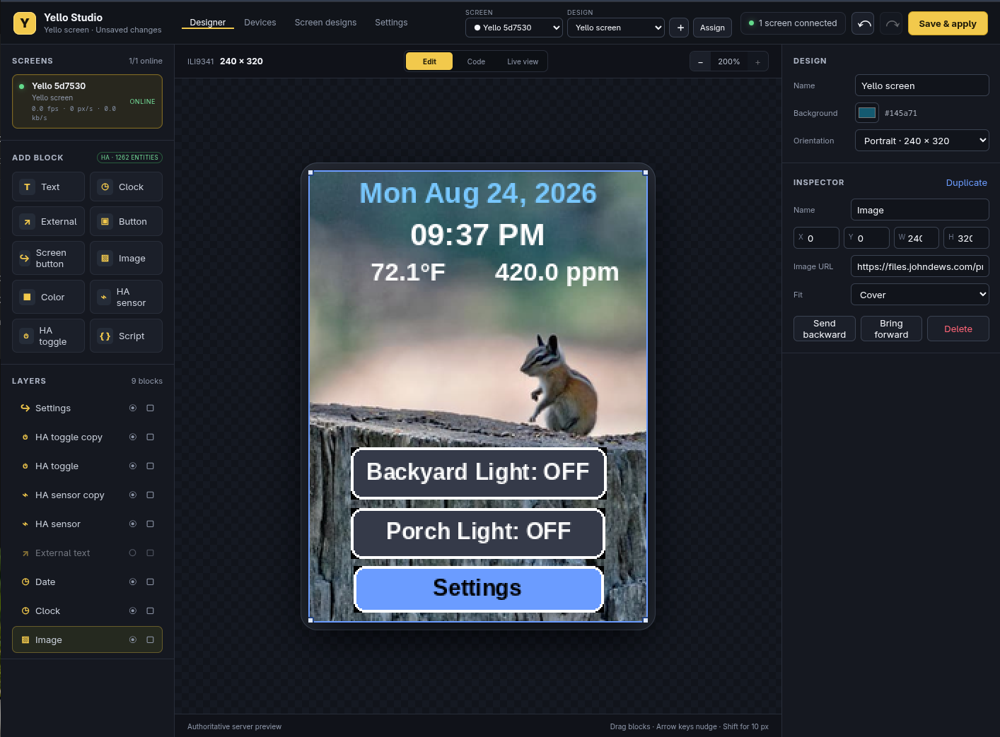
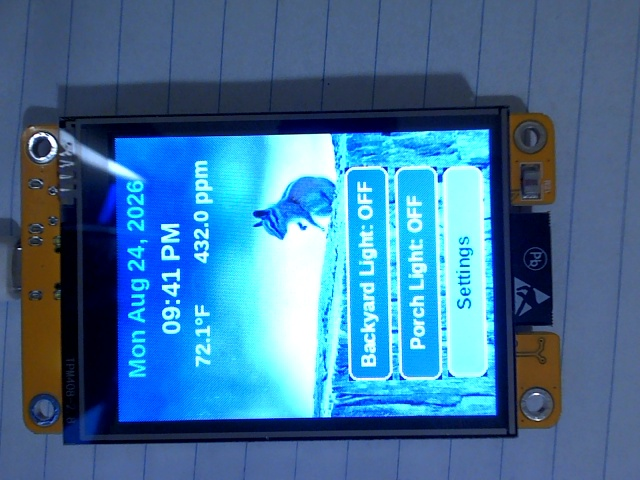

# ESP Yello Device

[](https://github.com/ChooseDews/Yello-Display-Server/actions/workflows/build.yml)
[](https://github.com/ChooseDews/Yello-Display-Server/actions/workflows/docker.yml)
[](https://github.com/ChooseDews/Yello-Display-Server/actions/workflows/windows.yml)
[](https://github.com/ChooseDews/Yello-Display-Server/actions/workflows/linux.yml)
[](https://github.com/ChooseDews/Yello-Display-Server/actions/workflows/macos.yml)

Turn a "Cheap Yellow Display" (ESP32-2432S028R, 2.8" ILI9341 touch screen) into
a network-rendered touch dashboard. A Rust server owns layout, rendering, and
dynamic data; the ESP32 is a dumb terminal that blits RGB565 regions received
over WebSocket and reports touch events back.

Design screens in the browser with **Yello Studio** — drag in text, clocks,
buttons, images, Home Assistant sensors/toggles, and sandboxed scripts, then
hit **Save & apply** to push them to every connected screen.

| Designer | On the device |
|---|---|
|  |  |

## Run the server

The easiest way to run the server is the prebuilt container:

```sh
docker pull ghcr.io/choosedews/yello-display-server:latest

docker run -d --name yello \
  --restart unless-stopped \
  -p 8080:8080 \
  -p 8765:8765 \
  -v yello-data:/data \
  ghcr.io/choosedews/yello-display-server:latest
```

Then open <http://127.0.0.1:8080/> to design; flash your display and point it
at the server (see [Connect a display](#connect-a-display)).

### Ports

| Port | Purpose |
|---|---|
| `8080` | Yello Studio web UI (HTTP) |
| `8765` | Device WebSocket gateway — the ESP32 connects here |

### Config and persistent data

All state lives under `/data` in the container. Mount a named volume (as
above) or a host directory there:

```sh
-v /opt/yello:/data
```

| Path inside `/data` | Contents | Env override |
|---|---|---|
| `studio.json` | Saved designs | `YELLO_STUDIO_PATH` |
| `secrets.json` | Home Assistant credentials, entered from the Studio settings page | `YELLO_SECRETS_PATH` |

Both files are created on first use, so an empty volume is fine. To pre-seed,
place the files in the mounted directory before the first start. Mount a
directory rather than individual files — the server saves by atomic rename.

Ports can be changed with `YELLO_WEB_PORT` / `YELLO_DEVICE_WS_PORT`; the
static web assets live at `YELLO_STATIC_DIR` (already set correctly in the
image).

### Docker Compose

`compose.yaml` builds the image from source and runs it with the same
ports and volume:

```sh
docker compose up --build -d
```

## Connect a display

Flash the ESP32 (the user must be in the `dialout` group; the local path
assumes ESP-IDF at `~/esp/esp-idf`):

```sh
cd firmware
. ~/esp/esp-idf/export.sh
idf.py build
sg dialout -c "idf.py -p /dev/ttyUSB0 flash"
```

### First-boot device setup

When no usable Wi-Fi configuration exists, the display opens **Device Setup**
before networking starts. Tap a field and use the local keyboard to enter:

- Wi-Fi SSID
- Wi-Fi password
- server hostname or LAN IP
- WebSocket port (normally `8765`)

Tap **Save** to validate and persist the settings in ESP32 NVS. The password is
masked and never logged. To edit an existing configuration, reboot the device
and hold the touchscreen for about one second while **HOLD SCREEN FOR SETUP**
is displayed. **Cancel** keeps the previously saved configuration.

A fresh repository build intentionally has an empty SSID, so a newly flashed
device enters setup.

## Yello Studio

The designer supports text, clocks, external text, buttons, screen buttons,
images, color blocks, sandboxed scripts, and Home Assistant sensor values and
entity toggles. Blocks can be selected, dragged, resized, reordered, hidden,
locked, duplicated, aligned, or deleted from a right-click menu, with
undo/redo throughout. Designs can be portrait or landscape, and each connected
screen can be assigned its own reusable design. **Save & apply** persists the
selected design atomically and refreshes every connected screen assigned to it.

A **Screen button** opens another saved design on the device that pressed it —
add a matching button on the destination design to build back, home, and
multi-page menu flows. The **Code** mode exposes the complete normalized
layout as JSON, schema-validated by the server before it is applied.

Configure Home Assistant from the dashboard Settings page to enable entity
browsing, state polling, and touch-driven toggles. The token never leaves the
server. Connected screen cards show rolling rendered FPS, changed pixels per
second, wire bandwidth, heartbeat age, WiFi RSSI, and device uptime; online
devices can be restarted from the Devices page.

## Build from source

```sh
cargo build --release --manifest-path server-rs/Cargo.toml
cargo test --manifest-path server-rs/Cargo.toml
cargo run --release --manifest-path server-rs/Cargo.toml
```

Running from source, config files land next to the working directory
(`studio.json` / `secrets.json`); override paths and ports with
`YELLO_STUDIO_PATH`, `YELLO_SECRETS_PATH`, `YELLO_STATIC_DIR`,
`YELLO_WEB_PORT`, and `YELLO_DEVICE_WS_PORT`.

## Benchmarks

`bench/run_bench.py` drives fake ESP32 devices (speaking the real binary wire
protocol) against the server and samples server CPU/RSS from `/proc`:

```sh
uv run bench/run_bench.py
```

Raw JSON and server logs land in `bench/results/` (gitignored). Methodology
and results are documented in [docs/server_benchmark.md](docs/server_benchmark.md).

## Repository layout

| Path | Contents |
|---|---|
| `firmware/` | ESP-IDF v5.5.5 project for the ESP32 display device |
| `server-rs/` | Rust server (tokio/hyper) + Yello Studio web UI + tests |
| `bench/` | Benchmark harness and generated results |
| `docs/` | Long-form write-ups (benchmark analysis, design demos) |
| `capture_frame.py` | Webcam-based screenshot tool for the physical device |

## Continuous integration

CI is split into workflows: server tests, firmware flash artifacts,
multi-architecture container images published to `ghcr.io/choosedews/yello-display-server`,
plus portable builds for Windows (exe bundle), Linux (AppImage), and macOS
(arm64 + x86_64). On `v*` tags the container is published and the desktop
bundles are attached to the GitHub release.

See [AGENTS.md](AGENTS.md) for confirmed pin mappings, panel quirks, capture
instructions, and the wire-protocol constraints.
